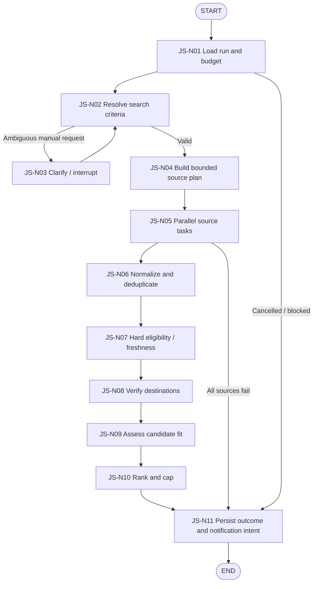
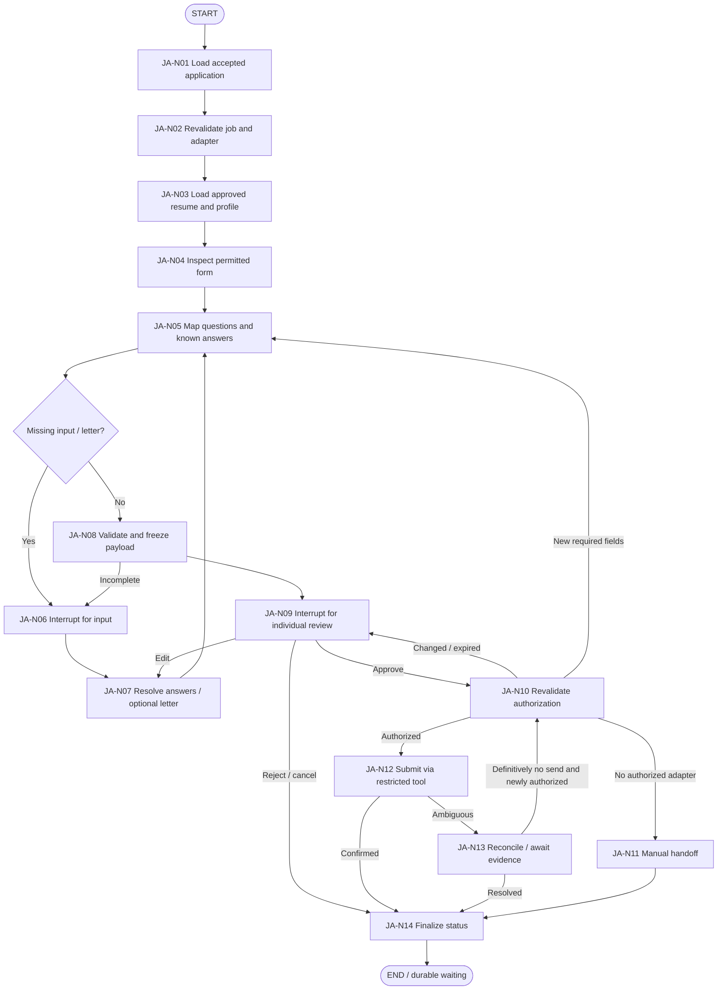

# Agent workflows and lifecycles

Version: 0.1 | Date: 2026-11-25 | Status: proposed low-level design; not implemented
Parent: [HLD v1.0](high-level-design.md) · [LLD](low-level-design.md) · [Job Search](../01-product/job-search-agent-requirements.md) · [Job Application](../01-product/job-application-agent-requirements.md) · [CA-005](https://github.com/palamsaiteja333/career-autopilot/issues/5)

## 1. Execution model

Two explicit LangGraph StateGraph workflows (specialized logical agents), registered by workflow type and version in one AgentCore Runtime deployment. Each has a distinct state schema, nodes and tool allowlist; there is no free-running supervisor or agent-to-agent conversation. FastAPI accepts commands; deterministic dispatch selects the graph. Job Search produces persisted job IDs. The candidate selects one; that explicit command starts Job Application. Both reuse services for profile, policy, checkpoint, telemetry and tool access. A future agent registers a graph, state schema, allowed skills/tools and command contract rather than rewriting existing nodes.

A run ID identifies a search or preparation workflow; an application ID identifies the business entity; a stable opaque thread ID identifies one graph execution across resumes, not an AgentCore session. A command ID identifies a single start/resume/reconcile action. The authenticated owner and execution context are derived from trusted state, never from model-supplied arguments. Checkpoint version, business version, invocation/lease epoch and graph version are distinct. Pin prompt, model configuration, skill and graph versions for reproducibility; incompatible in-flight workflows require explicit migration or the original supported version. See LLD for persistence and fencing.

## 2. Job Search Agent

### Input/output

Input: owner-scoped run ID; trigger (manual text or saved schedule); immutable preference snapshot (six role families, Canada-wide/Canada-eligible remote, 48h, source categories, cap 10); run start time; verified profile version or explicit absence; execution deadline and budget. Output: persisted ranked job IDs and evidence-based explanations, verified application links, unverified observations, coverage/source outcomes, counts, status, notification event and correlation ID.

All-source failure is FAILED; partial coverage is PARTIAL even if zero ranked results; completed zero is valid only with successful coverage. A cancellation or exhausted overall deadline can terminate at every safe boundary; valid partial results are persisted with explicit coverage and reason. Internal transient retries are bounded and not shown as free-running cycles.

| Node | Input → output | Execution and calls | Requirements |
|---|---|---|---|
| JS-N01 Load run | Command → verified run, snapshot, remaining budget | Deterministic repository reads, validate lease/owner, cancel flag and pinned versions; no model. | JS-001,012,016 |
| JS-N02 Resolve criteria | Saved preferences/manual query → validated SearchCriteria or clarification | Scheduled: no model. Manual: structured Bedrock extraction only if ambiguity/semantic interpretation is needed; use job-discovery skill; merge explicit overrides without changing saved preferences. Validate fields and allowlists. | JS-001–002 |
| JS-N03 Clarify | Ambiguities → pending user question / answer reference | Persist waiting state and interrupt; dashboard receives question, authenticated resume re-enters criteria resolution. No source calls while unresolved. | JS-002,012 |
| JS-N04 Plan sources | Criteria → bounded queries and per-source limits | Deterministic approved role aliases, geography terms, company catalog and provider limits; no candidate PII. Optional model query expansion deferred until eval shows value. | JS-003,005,015 |
| JS-N05 Discover | Source plan → provider records and outcomes | Concurrent bounded MCP read calls: search_web, search_greenhouse, search_lever, search_company_jobs. Resolve configured company/board IDs via catalog; generic Greenhouse/Lever endpoints are not global search. Respect pagination/licensing/rate limits. | JS-003,014 |
| JS-N06 Normalize/dedupe | Raw records → canonical posting refs and provenance | Deterministic schema normalization, provider ID and canonical URL matching; conservative cross-source dedup. Malformed data quarantined; no model by default. | JS-004,009 |
| JS-N07 Hard filters | Unique jobs → eligible candidates, exclusions, unknowns | Deterministic timestamps, known location and role constraints; for ambiguous role/location text use structured evidence extraction, not guessed eligibility. US-only, old, closed, submitted jobs excluded. Unknown mandatory evidence goes to unverified. | JS-005–007 |
| JS-N08 Verify destinations | Candidate URLs → verified active or unverified status | MCP fetch_job / verify_job_link using approved targets and redirect rules; provider status/body identity, not HTTP 200 alone. Recheck hard filters on newly retrieved evidence. | JS-008,015 |
| JS-N09 Assess fit | Eligible jobs + verified profile refs → evidence-backed match/gaps | Bedrock structured fit assessment using job-matching skill; batch bounded groups, minimal profile facts, no unsupported candidate claims; validate evidence IDs. No profile: role-only assessment explicitly labeled. | JS-010 |
| JS-N10 Rank/cap | Valid fit assessments → top <=10 | Deterministic ranking policy; ties by posting time then stable ID. No padding; exact weights and quality thresholds validated offline. | JS-011 |
| JS-N11 Finalize | Ranked refs + outcomes → terminal status, persisted results, outbox | Idempotent commit of status/results and notification intent; prior sightings tracked, no repeat alerts, source failures visible. | JS-012–016 |

### Model and tool call plan

Scheduled search has zero interpretation call; manual natural language has at most one successful criteria-extraction call (bounded correction on invalid output). Ambiguous eligibility evidence may need batched extraction; only source-supported evidence can pass hard filters. Fit assessment uses batches of up to 10 verified candidates initially, up to 100 normalized candidates inspected per run across sources. Proposed cap: 10 fit batches, 10 evidence batches, 1 criteria extraction plus bounded correction attempts within shared token/time/cost caps; these are ceilings, not expected call counts or entitlements to spend. Do not rank candidates whose assessment failed as verified fit; record incomplete coverage. No model is called for quotas, date arithmetic, dedup, sorting, persistence, retries or authorization. Test batch size, evidence extraction and pricing before release.

Example synthetic run: scheduled search → four source categories attempted → 60 raw observations → 45 unique → 18 pass hard filters/link checks → two fit batches → 10 ranked jobs, with exclusions and source coverage persisted. Numbers are illustrative only.

## 3. Job Application Agent

### Input/output

Input: authenticated explicit selection, stable job and destination IDs, application ID, approved immutable resume version, verified candidate profile/version, quota reservation, adapter capability, workflow version, budget/deadline. Resume commands contain validated answer/review/approval references, not raw queue payloads. Output: draft with unchanged original resume reference/hash, optional requested letter, field values and provenance, pending questions, payload version/hash, approval/attempt references, status and confirmation/handoff metadata.

Cancel is checked before every mutating boundary and may end a pre-send workflow. Once send is committed/in flight, cancellation cannot guarantee recall; reconcile rather than report falsely cancelled. Manual handoff is a persisted status, not a submission. The graph may terminate after generating a handoff or recording UNKNOWN; an authenticated reconciliation command can later update status.

| Node | Input → output | Execution and calls | Requirements |
|---|---|---|---|
| JA-N01 Load accepted | Selection command → app snapshot | Deterministic owner, duplicate, atomic quota reservation at ingress, lease validation; do not reserve again on retry. | JA-001–002 |
| JA-N02 Validate job/adapter | Job ref → current evidence and supported mode | Read-only MCP fetch_job / inspect capability; block closed, submitted, mismatched destination. | JA-003 |
| JA-N03 Load profile/resume | Approved refs → verified facts and immutable document refs | Deterministic private storage; verify checksum/version and consent scope; no resume rewriting. | JA-004,007 |
| JA-N04 Inspect form | Authorized destination → schema, required/conditional questions | Read-only MCP inspect_application_form or user-supplied questions. No credentials/PII/upload/autosave sent before approval. Unsupported inspection → assisted handoff or request user form; do not claim full completion. | JA-006,015,019 |
| JA-N05 Map fields | Form + facts → proposed values, provenance, unresolved | Exact mapping first; structured Bedrock semantic mapping for ambiguous field types using answer-mapping skill; model returns fact IDs/proposed text, deterministic evidence and scope checks. Sensitive declarations require direct user confirmation as appropriate. | JA-007–008 |
| JA-N06 Await input | Unresolved questions → durable task + interrupt | Idempotently register pending task, checkpoint, return waiting; no worker/browser held open; accept only authenticated matching version. | JA-008–010,018 |
| JA-N07 Resolve input | Answer refs/consent/letter request → new draft facts/artifact refs | Deterministic validation and optional save with scope; invoke Bedrock cover-letter skill only on request; ground claims, store versioned draft. Conditional questions re-evaluated, edits invalidate prior approval. | JA-005,009–010 |
| JA-N08 Validate/freeze | Draft → exact payload manifest/hash or issues | Deterministic required/optional, types, size/hash, provenance, destination, declaration and completeness checks; optional model quality check never overrides policy. | JA-011 |
| JA-N09 Await review | Frozen manifest → pending review / authorized decision ref | Persist interrupt; user sees exact fields/docs/destination, edits/rejects/cancels or approves individually. Server records approval separately, never model-generated. | JA-012–013 |
| JA-N10 Revalidate | Approval ref + latest form/job/policy → permitted action or new review | Deterministic verification of expiry/revocation/hash/owner/destination, current form schema and attempt state; read-only job/form refresh. Any change routes back; no new send after cancellation. | JA-003,013,015 |
| JA-N11 Handoff | Approved or clearly labeled incomplete draft → safe local package | Provide original docs/answers, missing items and link; no external data transfer. Record manual handoff, later user confirmation distinct from provider confirmation. | JA-014 |
| JA-N12 Submit | Verified approval + attempt ref → confirmed/definite failure/unknown | Deterministic dispatch to narrow MCP submit_approved_application; tool repeats independent authorization and obtains attempt lock. Model has no direct submission authority. Mock ATS guaranteed path; live disabled until authorized. | JA-014–016,019 |
| JA-N13 Reconcile | Durable attempt ref → evidence/outcome or pending task | Read-only MCP lookup_submission_status where supported; human confirmation/verified provider record otherwise. No blind retry, no model deciding that timeout means failure. | JA-016–017 |
| JA-N14 Finalize | Outcome → durable business transition/audit/notification | Idempotent persistence, release lease, dashboard-only notice, no raw private logs. | JA-017–020 |

### Model and tool call plan

No model for selection, quota, resume retrieval/hash, exact field mapping, approvals, submission, cancellation, status transitions or retries. One structured mapping batch per up to 15 unresolved supported questions (proposed), maximum four batches per automated segment; split conditional form pages and checkpoint. Optional cover letter model call only on request, with evidence IDs and one bounded correction; never invent facts. A new human resume segment rechecks budgets, cancellation and current form, and may call the model again only for newly unresolved fields. Reuse checkpointed outputs when safe. Tool calls: fetch_job, inspect_application_form, optionally lookup_submission_status, and only after valid approval submit_approved_application. Original resume is retrieved internally, not via a broadly model-accessible tool.

### Example and failure scenarios

| Scenario | Node/route | Expected durable outcome |
|---|---|---|
| 12 of 15 fields known | N05 → N06 | AWAITING_INPUT; task lists three unresolved fields; no external disclosure. |
| User returns tomorrow | N06 resumes using same thread; N07 → N05 | Existing draft; no new quota reservation. |
| Employer requires letter | N06 asks user; N07 only if requested | User can supply their own or request generation; otherwise required field blocks completion. |
| User edits answer after approval | N10 → N09 (or N05) | Previous approval invalid, new payload version reviewed. |
| Duplicate approval command | N10 / N12 | Existing attempt returned or reconciled; no second external send. |
| Crash after remote send before recording result | N12 → N13 on recovery | UNKNOWN; check attempt ledger/provider evidence, not blind retry. |
| Cancel before send | Any pre-send node → N14 | CANCELLED; no external submission. |
| Cancel during send | N12/N13 | Outcome unknown or confirmed; no false reversal. |
| Unsupported live site | N04 or N10 → N11 | MANUAL_HANDOFF, clearly indicate unknown/incomplete fields; not submitted. |

## 4. LangGraph concepts to learn

StateGraph nodes receive state and return partial state updates; edges encode deterministic transition rules; reducers merge parallel updates deliberately (keyed by source/task ID, not unbounded append). Conditional edges/Command route based on validated outputs; dynamic fan-out can use Send if warranted, but bounded source tasks are sufficient initially. Checkpointer persists graph state; use stable thread ID and Command(resume=...) to resume an interrupt. Nodes can replay from their start on resume, so never place irreversible unguarded side effects before interrupt; isolate effects and use durable idempotency. Checkpointer and business database are not assumed atomic together: reconcile versions and checkpoint/ledger before executing next command. See [LLD](low-level-design.md).

## 5. References

- [LangGraph graph API](https://docs.langchain.com/oss/python/langgraph/graph-api)
- [LangGraph interrupts](https://docs.langchain.com/oss/python/langgraph/interrupts)
- [LangGraph durable execution](https://docs.langchain.com/oss/python/langgraph/durable-execution)
- [AgentCore overview](https://docs.aws.amazon.com/bedrock-agentcore/latest/devguide/)
- [Agent Skills specification](https://agentskills.io/specification)

No implementation, actual model calls, live tools or measured performance. Node IDs and call caps are proposed design decisions for review.
