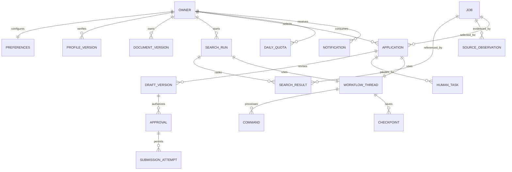

# CareerAutopilot — Data model and persistence

Version: 1.0 | Date: 2026-11-25 | Status: owner-approved design baseline; feasibility testing pending
Parent: [HLD v1.0](high-level-design.md) · [LLD v1.0](low-level-design.md) · [Agent workflows v1.0](agent-workflows.md) · [NFR](../01-product/non-functional-requirements.md) · [Threat model](../04-security/threat-model.md) · [CA-006](https://github.com/palamsaiteja333/career-autopilot/issues/6)

## 1. Design goals

DynamoDB on-demand and private S3 in preferred Canada Central (conditional on regional feasibility). Model access patterns before keys. Single owner initially, owner-scoped data from day one. Separate business truth, orchestration/checkpoints, privileged authorization, and deletion control. No full-table scans in request path, no raw private data in queue or telemetry, no model access to database credentials. This is a logical schema, not CDK, Pydantic or application implementation.

## 2. Entity relationships

Relationships are logical: DynamoDB does not enforce foreign keys. Domain services enforce ownership, references, uniqueness and lifecycle invariants in transactions/conditional writes. One application per owner and canonical requisition in MVP; reopen/resume same draft when safe. Job aliases map provider IDs/canonical URLs to stable internal job IDs; ambiguous dedup does not merge silently.

## 3. Approved table strategy

Five logical DynamoDB tables per deployed environment, all on-demand initially. Actual resource count and names depend on checkpointer library requirements and cost/security validation. Multi-table design favors privilege separation and independent lifecycle over a single-table layout; use composite keys inside each domain. All keys use opaque IDs (no names, email, resume text, raw URL or applicant answers). Prefix examples are illustrative.

| Table | Purpose | Access boundary |
|---|---|---|
| ca-domain | Candidate/profile/document metadata, jobs, search results, drafts/tasks/notices | Scoped domain services; no direct model access |
| ca-execution | Run/thread metadata, command/idempotency, lease, transition intent, outbox and daily quota | Trusted ingress, dispatcher, relay/reconciler with separate limited roles |
| ca-authorization | Approval and attempt ledger, per-job submission uniqueness | Trusted approval service and restricted submission/reconciliation service only; model runtime cannot directly mutate |
| ca-checkpoints | LangGraph checkpoint metadata and writes, S3 offload as needed | Checkpointer service identity; schema follows validated library, no general dashboard access |
| ca-deletion | Deletion journal/tombstones and restore write-disable control | Restricted deletion/recovery service; independent recovery boundary, not overwritten by routine table restores |

A logical policy service may be implemented as narrow Lambda operations, not additional always-running services. IAM permissions alone cannot express all domain rules. Server-side authorization and conditional state checks remain mandatory. Direct runtime writes to approval/attempt ledger are prohibited. Environment isolation: separate resources and roles, preferably distinct AWS accounts for production vs non-production; synthetic staging data only. No need for global tables or replicated search index in MVP.

## 4. Domain table key design

PK and SK are string keys. All domain records owner-scoped. Entity collections are grouped by resource or owner to support bounded queries; use paginated reads. Time-ordered sort keys use UTC ISO-8601 or fixed-width sortable epoch + unique ID. Each mutable item has version, updated_at and type; immutable revisions have created_at and hash. An owner registry item records deletion generation and status; maintain an owner-scoped resource inventory with references to partition families, object versions and checkpoint threads as part of creation/transition transactions, reconciled against actual storage by the deletion service.

| Entity | PK | SK | Essential attributes |
|---|---|---|---|
| Preferences/current profile pointer | OWNER#o | PREF / PROFILE#CURRENT | Roles, timezone, config version, current approved profile/resume refs |
| Profile version | OWNER#o | PROFILE#version | Verified fact refs, source, consent/version, created_at; bounded metadata |
| Verified fact / reusable answer | OWNER#o | FACT#id#version | Value or private artifact ref, provenance, confirmed_at, scope, sensitivity, validity/expiry |
| Document metadata | OWNER#o | DOC#id#version | S3 key/version ID, SHA-256, size/type, scan and approval status |
| Job | OWNER#o#JOB#j | META | Employer/title, canonical destination ref, source timestamps/precision, eligibility/active evidence |
| Job identity alias | OWNER#o#ALIAS#hash | META | Provider and posting ID or normalized URL digest → job ID; collision checked |
| Source observation | OWNER#o#JOB#j | OBS#source#time#id | Source evidence ref, observation/posting dates, status, expiry |
| Search run summary (read projection) | OWNER#o#RUN#r | META | Run status, trigger, start time, coverage summary and authoritative execution/thread reference |
| Search run result | OWNER#o#RUN#r | RESULT#rank#j | Job ref, evidence/match/gaps, rank, seen status |
| Search coverage/exclusions | OWNER#o#RUN#r | COVERAGE#source or EXCLUSION#id | Counts, error code, verified/unverified status, expiry |
| Application | OWNER#o#APP#a | META | Job/destination, current draft version, status, workflow/thread refs, state version |
| Application uniqueness | OWNER#o#APPJOB#j | META | Canonical job ID → application ID, created once |
| Draft version | OWNER#o#APP#a | DRAFT#version | Form version, exact field/provenance refs, immutable original resume ref/hash, optional letter, manifest hash |
| Human task | OWNER#o#APP#a or OWNER#o#RUN#r | TASK#task_id | Type, expected version, status, pending questions/decision refs, expiry if appropriate |
| Notification | OWNER#o | NOTICE#time#id | Event type, resource ref, read state, dedupe key; no raw sensitive content |

Draft values containing sensitive information remain private and versioned; use small encrypted records or private S3 artifact refs, not an ever-growing checkpoint blob. Search text, URLs and artifacts are untrusted even though public; search interests remain private. Limit size well below DynamoDB's 400 KB item maximum and offload large text to S3. Do not bundle all 100 postings into one transaction or one item.

### Sparse secondary indexes

| Index | Partition key | Sort key | Use |
|---|---|---|---|
| Domain GSI1 owner timeline | OWNER#o#TYPE#entity | time#id | List recent runs/applications/jobs/documents by entity |
| Domain GSI2 tasks/status | OWNER#o#TASK#status | time#id | Dashboard pending questions/approvals/reconciliation |
| Execution GSI1 work due | ENV#e#WORK#type#status | due_at#id | Sweeper queries unpublished outbox, expired lease, incomplete transition |
| Optional authorization reconciliation index | ENV#e#ATTEMPT#status | due_at#id | Restricted service locates UNKNOWN/in-flight attempts |

Use sparse projected metadata/keys only, no raw PII in indexes. At low scale these partitions are adequate; revisit sharding only after measurement. GSI reads are eventually consistent: never use them to grant approval, enforce quota, deduplicate external sends or decide resource ownership. Use strongly consistent base-table reads and conditional transactions for those decisions. Dashboard may briefly show stale projections; mutations revalidate base truth and return current version on conflict.

## 5. Execution, approval and checkpoint keys

| Record | Table | PK | SK | Critical data |
|---|---|---|---|---|
| Workflow thread | execution | OWNER#o#THREAD#t | META | graph/state version, run/app refs, lease epoch/expiry, checkpoint and business markers |
| Command | execution | OWNER#o#THREAD#t | CMD#c | type, expected version, payload ref, status, correlation ID |
| Outbox | execution | OWNER#o#THREAD#t | OUTBOX#c | publication/processing state, retry and due time |
| Transition intent | execution | OWNER#o#THREAD#t | TRANSITION#id | expected versions, checkpoint marker, result ref, reconciliation state |
| Request idempotency | execution | OWNER#o#IDEMP#operation | key_digest | canonical request hash, outcome ref, expiry; reject key/body mismatch |
| Schedule slot | execution | OWNER#o#SCHEDULE#config | SLOT#anchor_instant | stable run ID; one logical acceptance per elapsed 24h slot |
| Daily quota | execution | OWNER#o#QUOTA | DATE#YYYY-MM-DD | count, quota limit, timezone/policy version |
| Quota reservation | execution | OWNER#o#QUOTA | RES#app_id | accepted date, immutable reservation reference |
| Approval | authorization | OWNER#o#APP#a | APPROVAL#id | exact payload/destination/form/attachment hashes, approved_at, expires_at, revocation/version, decision |
| Submission gate | authorization | OWNER#o#APP#a | GATE | current approval/version, cancellation state, in-flight attempt, outcome, durable send lock |
| Attempt | authorization | OWNER#o#APP#a | ATTEMPT#id | grant ref, manifest hash, provider idempotency ref, state, evidence type, timestamps |
| Job submission uniqueness | authorization | OWNER#o#JOB#j | SUBMISSION | confirmed/unknown/in-flight lock and application/attempt ref |
| Graph checkpoint | checkpoints | Library-managed thread/namespace | Library-managed checkpoint/write identifiers | Stable thread ID, graph version, checkpoint metadata and offload references |
| Deletion journal | deletion | OWNER#o | TOMBSTONE#generation or TASK#id | opaque deletion generation, affected resource refs, effective_at, purge progress, backup expiry |
| Restore gate | deletion | ENV#e | RESTORE#current | write_disabled flag, restore generation, reconciliation evidence, authorized unlock |

Do not hand-design the internal checkpointer schema until the selected AWS LangGraph package is compatibility-tested. Thread ID and checkpoint namespace map to owner and workflow through trusted metadata; no arbitrary thread lookup from model/client. Checkpoint fencing must cover actual checkpoint writes or prove single-writer exclusion. Prefer a thin checked persistence adapter if necessary; never assume business version fencing alone protects checkpoint history.

## 6. Access patterns

| Operation | Lookup / consistency |
|---|---|
| Fetch preferences, profile, original approved document | Owner collection GetItem / Query; strongly consistent current pointer |
| Deduplicate posting | Conditional alias put / read canonical identity; resolve ambiguity without forced merge |
| Display ranked search | Query run result prefix ordered by rank, max 10 |
| List application history | Query owner timeline GSI, paginate; confirm exact record on selection |
| Find pending tasks | Query task GSI, strongly revalidate task/expected version before answer |
| Start application with quota | TransactWriteItems across uniqueness, quota, reservation, application/thread/command/outbox |
| Approve / invalidate | Transaction on exact draft/app/task and authorization ledger; compare versions |
| Authorize send | Transaction on approval, gate, attempt, per-job uniqueness, current application and cancellation state |
| Resume graph | Trusted thread mapping and checkpoint; verify task, business/checkpoint versions and lease |
| Recover command or attempt | Sparse due/status index then base-table verification and conditional claim |
| Delete candidate data | Query known owner collections and deletion inventory (including S3 versions/offload); no request-path global scan |

All multi-item transactions stay within DynamoDB service limits (100 distinct items, aggregate 4 MB); never rely on transaction request token alone for long-term deduplication. Persist durable business idempotency records. If projections are updated outside transaction, make them idempotent and reconcile.

## 7. Atomic invariants and recovery

### New application and quota
Authenticated selection derives owner and canonical job. In one transaction: check active owner; reserve unique application/job identity; conditionally increment Toronto local-day quota only if count < 5 (initialize absent counter); put reservation, application/thread, command, idempotency and outbox. Concurrent duplicate selection returns existing application without quota increment. No refund for failed/cancelled accepted preparation; retry/resume existing draft consumes no new slot. Day boundary follows America/Toronto, including DST; do not use fixed 24h quota TTL. Prevent preference timezone changes from reopening old quota days; policy/version strategy to validate if customization introduced.

### Individual approval
User reviews exact immutable manifest; authenticated approval service derives canonical serialization/hash from stored manifest (canonical encoding spec to validate), checks current draft/form/destination and task version, writes approval and gate version plus resume command atomically. Approval expires after 24 elapsed hours, checked by server clock, not TTL deletion. Draft/profile/document changes affecting payload, revocation and pre-send cancellation invalidate gate transactionally. No reuse across applications.

### Submission attempt and last cancellable boundary
Restricted executor rechecks job/form/policy and exact manifest; transaction conditionally verifies owner, valid approval, not cancelled, matching draft version, no unknown/confirmed competing attempt, and reserves attempt/in-flight gate + per-job uniqueness + business SUBMITTING. Only the winning attempt may send. A cancellation concurrent with send reservation either wins before reservation or becomes cancellation requested after reservation (no promise of recall). Use provider idempotency when available; otherwise one external send attempt and reconcile uncertainty. On confirmed result write outcome/gate/application atomically; on timeout or crash mark UNKNOWN after recovery. Definitive no-send evidence and fresh approval required before releasing lock and retrying. Expired approval never makes an uncertain attempt safe to repeat.

### Checkpoint and business consistency
Use transition intent and version markers per LLD: persist idempotent intent, checkpoint with fenced writer or proven exclusive ownership, reconcile marker, publish actionable task only once both agree. No assumed cross-store transaction. If crash occurs after checkpoint but before business projection, recover from checkpoint plus intent; if intent exists but checkpoint absent, replay only safe idempotent work. Block inconsistent resumes and external sends. Test stale invocation writing after lease expiry, not just duplicate commands. Store final attempt status in ledger independently of graph.

## 8. S3 document storage

Separate private buckets/prefix boundaries for candidate documents, checkpoint artifacts and public UI origin. Proposed private key shapes:

- documents/owner/<opaque-owner>/resume/<doc-id>/<logical-version>/original
- documents/owner/<opaque-owner>/letters/<app-id>/<version>/draft
- documents/owner/<opaque-owner>/applications/<app-id>/<draft-version>/manifest
- checkpoints/owner/<opaque-owner>/thread/<thread-id>/<checkpoint-id>/<artifact-id>
- quarantine/owner/<opaque-owner>/<upload-id>

Use S3 versioning, block public access, TLS-only, AWS default encryption at rest (SSE-S3 for S3; AWS-owned key for DynamoDB); separate service roles and resource policies by boundary and environment; customer-managed KMS keys deferred unless a validated requirement arises. UI bucket has no candidate data. Upload uses short-lived scoped URL with expected constraints, quarantine until validation/scan, record trusted server-verified checksum, object version and content type. Do not trust filename, client-provided type or ETag as content hash. Approved original is logically immutable; create a new version rather than overwrite. Approved private access: short-lived presigned URLs (maximum five minutes initially), issued only after owner, document version and deletion-generation checks. Scope temporary signing credentials and S3 policy to the exact object/version and action; use TLS, signature-age limits, no public access or caching, and redact URLs. Presigned URLs are bearer capabilities: a database tombstone or short expiry alone cannot revoke them. Validate object/version-specific explicit deny or permission revocation (including old versions and concurrent requests) before enabling private downloads. Block new issuance immediately on deletion; verify outstanding URLs fail after revocation. If this cannot meet immediate retrieval revocation, keep direct private downloads disabled and seek owner review of an authenticated broker or other compliant design; no silent five-minute exception. Already downloaded content or an in-progress transfer cannot be recalled. Upload intents target quarantine only; deny late confirmation after deletion and purge late uploads.

## 9. Retention, deletion and disaster restore

Approved retention: profile/resume until user deletes; search metadata 90 days; operational logs/traces 30 days; minimum application/audit metadata 180 days; backups <=30 days; active private data purge within 7 days, immediate revocation of live retrieval. Proposed implementation: expire normal search records and operational projections at configured timestamps; query/get checks expiration even before TTL cleanup. TTL is asynchronous, not approval/security enforcement or guaranteed purge. Active delete worker enumerates and explicitly deletes all relevant domain, execution, authorization private fields, checkpoint/offload and S3 object versions/delete markers; track verified completion. Preserve only necessary redacted audit/anti-duplicate metadata under approved retention, distinguish from private payload. After authorized dedupe evidence expires, do not claim indefinite duplicate protection; recheck candidate/provider history and require human confirmation if prior submission is uncertain. Stop new workflows and fence running commands on deletion; check deletion generation on each private read, model/tool call and send. Deletion cannot undo already transmitted employer data.

Set DynamoDB PITR recovery period to 30 days maximum (or shorter if required), configure S3 version/noncurrent lifecycle and backup lifecycle. AWS documents that deletion of a PITR-enabled DynamoDB table can create a system backup retained 35 days; this conflicts with strict 30-day backup policy unless addressed. Treat this as deployment gate: prevent routine table deletion, validate whether disabling PITR before planned deletion avoids extra backup and verify managed backup behavior; if strict policy cannot be met, require explicit owner-approved policy exception or different backup design, never silently ignore. S3 delete markers do not permanently delete versions; enumerate and delete actual versions for active purge. Verify lifecycle timing, backup expiry and restore tests.

Deletion journal must remain authoritative independently of ordinary data restores, and survive loss/rollback of restored tables; validate independent backup/recovery and minimize opaque tombstone data. Keep tombstone until all recoverable copies/restore windows have passed (proposed 180-day maximum for minimal audit, review). On restore: global external-write gate disabled by default; restore into isolated resources, apply latest deletion journal and retention filtering, verify document/checkpoint refs, rebuild projections, reconcile approvals/attempts and external outcomes, test owner access, then explicitly unlock. If journal integrity or external outcomes uncertain, remain fail-closed. RTO 4h and RPO 24h targets apply to recoverable single-region disaster; ordinary restart should lose no acknowledged approvals/answers. No promise of cross-region DR.

## 10. Validation and references

Owner decision 2026-11-25: preserve maximum 30-day backup retention without exception. See [AWS presigned URLs](https://docs.aws.amazon.com/AmazonS3/latest/userguide/using-presigned-url.html), [revocation FAQ](https://docs.aws.amazon.com/prescriptive-guidance/latest/presigned-url-best-practices/faq.html), [S3 default encryption](https://docs.aws.amazon.com/AmazonS3/latest/userguide/UsingServerSideEncryption.html) and [DynamoDB encryption](https://docs.aws.amazon.com/amazondynamodb/latest/developerguide/EncryptionAtRest.html).

Tests: key/access pattern walkthrough, consistent reads, simultaneous sixth application, duplicate selection and request mismatch, DST rollover, changed approval and concurrent cancel/send, unknown send recovery, checkpoint fencing, GSI lag, deletion during run, expired TTL item still present, S3 version purge, restore with old deleted data and audit integrity. Validate actual library/schema, IAM, storage/backup pricing and regional feasibility before implementation release.

References (AWS docs checked 2026-11-25): [DynamoDB constraints](https://docs.aws.amazon.com/amazondynamodb/latest/developerguide/Constraints.html), [transactions](https://docs.aws.amazon.com/amazondynamodb/latest/developerguide/transaction-apis.html), [TTL](https://docs.aws.amazon.com/amazondynamodb/latest/developerguide/TTL.html), [expired item handling](https://docs.aws.amazon.com/amazondynamodb/latest/developerguide/ttl-expired-items.html), [PITR and system backups](https://docs.aws.amazon.com/amazondynamodb/latest/developerguide/PointInTimeRecovery_Howitworks.html), [S3 version deletion](https://docs.aws.amazon.com/AmazonS3/latest/userguide/DeletingObjectVersions.html).

No tables, keys, buckets, real data or infrastructure have been created. Five logical tables, default encryption, short-lived presigned access with validated revocation, and remaining data design are approved subject to feasibility. Revocation, backup retention (including PITR table deletion), IAM, checkpoint fencing and deletion/restore drills remain blocking validation gates for real data. No measured or legally certified controls.
