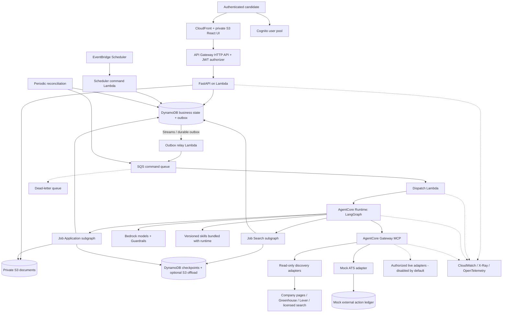
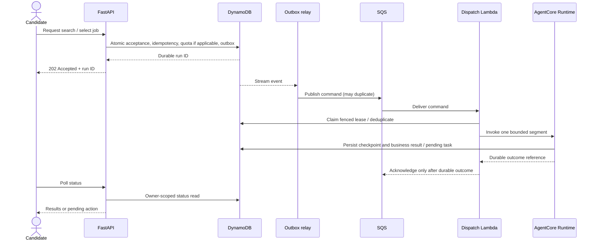

# CareerAutopilot — High-Level Design (HLD)

Version: 1.0 | Date: 2026-11-25 | Status: owner-approved architecture baseline, subject to feasibility validation; no implementation
Parent: [PRD](../01-product/product-requirements.md), [NFR v1.0](../01-product/non-functional-requirements.md), [evaluation plan](../01-product/evaluation-plan.md), [CA-004](https://github.com/palamsaiteja333/career-autopilot/issues/4)

## 1. Drivers and boundaries

Single authenticated owner, 30 scheduled + 10 manual searches and 30 application preparations/month as reference load; two concurrent searches and five concurrent preparation requests. Search p95 120 s, API p95 500 ms, application automated segment p95 90 s, maximum 300 s automated segment, 99.5% core API SLO, USD 50/month target. Daily elapsed 24-hour discovery, 48-hour freshness, 10 ranked results, five explicitly selected preparations per Toronto calendar day. Original resume, cover letter on request, dashboard HITL and individual approval. Live submission only when independently authorized. No new user-facing agents or SaaS scale assumed.

## 2. Architecture style and component diagram

Approved approach: modular monolith at source-code/domain level, separate deployed API, orchestration runtime and narrow tool adapters. Serverless control plane and event-driven execution. LangGraph controls workflow transitions; AWS infrastructure transports commands and executes bounded segments. No additional LLM supervisor for two known workflows.



IAM, encryption, secrets, budget controls, deployment and audit are cross-cutting. Arrows represent logical flows, not network topology. Browser access is optional, permitted-only; no external account is accessed by default. Candidate documents are never in the public frontend bucket. Frontend uses private S3 origin access, HTTPS, Cognito sign-in with authorization code + PKCE, and authenticated API calls; self-registration disabled for MVP. Optional MFA; default AWS encryption (SSE-S3 and DynamoDB AWS-owned keys). Short-lived signed document URLs require ownership checks, validated revocation before private download release, upload validation and quarantine.

## 3. Service choices and alternatives

| Concern | Approved MVP baseline | Alternatives / trade-off |
|---|---|---|
| Dashboard | React/TypeScript, S3 + CloudFront | No always-on frontend server; use private S3 origin. |
| Identity | Cognito user pool + HTTP API JWT authorizer | Custom auth unnecessary; validate issuer, audience/client and scopes; enforce owner again in FastAPI. |
| API | FastAPI on standard Lambda with ASGI adapter | ECS Fargate + ALB offers persistent processes and easier streaming but recurring idle cost; revisit if latency/concurrency/streaming requires it. |
| Scheduling | EventBridge Scheduler rate of one day | Cron at fixed local clock differs from elapsed 24 hours during DST. Use stable scheduled-event ID and configurable anchor. |
| Dispatch | DynamoDB transactional outbox + Streams relay + SQS Standard + DLQ + Lambda worker | Direct API-to-SQS dual writes risk lost jobs; Step Functions adds orchestration but would duplicate LangGraph control flow for MVP. SQS delivery is at least once, not exactly once. |
| Agent execution | AgentCore Runtime hosting Python LangGraph graph/subgraphs | Lambda-only simpler and fallback; ECS offers control but fixed runtime overhead. AgentCore is selected for learning isolation, managed runtime and observability; validate invocation contract and region. |
| LLM | Amazon Bedrock model interface, structured outputs, Guardrails | Compare inexpensive and stronger model variants on goldens; no specific model chosen yet. No model for deterministic filtering, quota or approvals. |
| Tools | MCP client in runtime, AgentCore Gateway, narrow Lambda-backed tools | Direct Python functions for internal deterministic logic. Build own MCP server/client locally and evaluate remote server on Runtime or Gateway target; do not expose everything as MCP. |
| Skills | Versioned SKILL.md and approved supporting instructions loaded by workflow | Skills are procedural context, not executable permission grants; only reviewed bundled skills, never arbitrary external instructions. |
| State | DynamoDB on-demand business tables, separate checkpoint persistence; S3 private documents and large checkpoint offload if needed | RDS PostgreSQL offers rich joins, relational constraints and mature checkpointer options but adds cost/networking; re-evaluate if access patterns need it. |
| Memory | Verified profile/answer store + LangGraph checkpoint | AgentCore Memory optional for future contextual recall, not source of legal or candidate truth and not needed for MVP. No vector DB/RAG service until a concrete retrieval requirement. |
| Browser | Mock ATS first; optional AgentCore Browser for authorized use | Manual handoff default for unsupported sites. Browser does not grant permission, and no pre-approval data transmission. |
| Monitoring | ADOT/OpenTelemetry, AgentCore Observability, CloudWatch logs/metrics/dashboards/alarms, X-Ray traces | No extra hosted tracing service initially; validate trace propagation and privacy-safe exporter config. |
| IaC/deployment | AWS CDK Python, GitHub Actions OIDC, ECR for runtime image | Separate dev/staging/prod configuration and IAM/data; only one full environment continuously deployed initially. No long-lived CI keys. |

## 4. Request flow and durable scheduling



The scheduler uses a small command ingress with the same durable acceptance path and schedule-slot idempotency. A periodic reconciler examines stuck outbox records, expired leases, checkpoint/business-state mismatches and incomplete runs. Outbox events remain until confirmed, so stream retention or relay failure does not silently lose accepted work. Outbox publishing and SQS delivery can repeat; consumer uses a durable command ID, application/run ID and versioned lease/fencing. Commit checkpoint plus business state through explicit recoverable boundaries: if the checkpointer and business store cannot share a transaction, use versioned transitions and reconcile before advancing. Exact schema and protocol belong in LLD.

API requests never block on inference or human input. 202 means durable acceptance, not completion. Worker synchronously awaits one bounded runtime invocation segment in the initial design (no second asynchronous job layer); set dispatch timeout and SDK read timeout above segment deadline, validate service limits, configure SQS visibility per AWS guidance and handle per-record failures. Runtime and worker may fail independently; never assume a disconnected invocation stopped. On ambiguous outcome reconcile durable state and fence stale work before retry. Target 300 s segment deadline; no worker waits days. Use status polling initially (e.g. bounded backoff), not WebSocket or SSE.

## 5. Human-in-the-loop and submission

```mermaid
sequenceDiagram
  actor U as Candidate
  participant A as FastAPI
  participant D as Business state + outbox
  participant R as LangGraph Runtime
  participant C as Checkpoint store
  participant T as Authorized submission tool
  R->>C: Persist graph interrupt
  R->>D: Record pending question
  Note over R: End invocation / release worker
  U->>A: Provide answer (optional consent to save)
  A->>D: Validate owner + expected version; save answer/resume command
  Note over D,R: Outbox / SQS / dispatcher delivers resume
  R->>C: Load stable thread ID; resume
  R->>D: Store exact reviewed payload version
  U->>A: Approve individual application
  A->>D: Atomically bind approval and enqueue execution
  Note over D,R: Worker invokes new bounded segment
  R->>D: Recheck approval, quota semantics, job and destination
  alt Authorized and valid
    R->>T: Submit using durable attempt ID
    T-->>R: Confirmation or uncertain outcome
    R->>D: Record submitted or unknown / reconciliation
  else No authorized adapter
    R->>D: Manual handoff, not submitted
  end
```

A graph interrupt is persisted before ending the segment, not a sleeping process or live browser session. New AgentCore runtime sessions can resume from a stable LangGraph thread ID after days. Keep approval ledger independent of model state, with expiry/revocation/version checks. Submission adapter independently validates approval and attempt ownership immediately before external send; record durable in-flight attempt and fence concurrent actions. Never auto-retry uncertain external writes. If tool or remote ATS lacks idempotency/confirmation, use manual reconciliation; exactly-once external side effect cannot be promised. No external resume upload, autosave or candidate-data transmission before approval. Mock submission is the only guaranteed automated path for MVP.

## 6. Logical data boundaries

Business state: candidate identity/preferences/verified answer provenance, job/source identity, run status, application status/quota, approval and submission ledger, notifications and outbox. Graph checkpoint: execution position, pending interrupt and bounded references, separate from authoritative approval ledger. Private object storage: original immutable versioned resume, requested cover letter and large artifacts; owner-scoped access and deletion tracking. Queue: identifiers and versions, not raw resume/answers. Audit/telemetry: opaque IDs, timings and outcomes, no raw private payloads. Avoid copying full candidate information into each checkpoint; redact/minimize data and enforce approved retention including offloaded artifacts and backups. See [data model v1.0](data-model.md) and [threat model v1.0](../04-security/threat-model.md) for approved access patterns, deletion strategy, recovery protocol and trust boundaries; feasibility remains pending.

## 7. Trust boundaries and guardrails

- Browser/UI is untrusted; verify token and owner server-side, do not trust client-supplied candidate IDs or approval assertions. Restrict CORS and validate inputs.
- Treat external job text and MCP outputs as untrusted data. Use Bedrock Guardrails for relevant content and prompt-attack checks, plus structured output, deterministic eligibility, grounded fact validation and independent authorization.
- Distinct read-only discovery tool permissions vs application preparation vs submission; use narrowly scoped IAM/service roles, destination allowlists and schema validation. Do not give an agent arbitrary HTTP, shell or broad secrets access. Validate redirects and block private/metadata endpoints (SSRF).
- Candidate data stays in private stores; send minimum necessary data to approved Bedrock processing only, validate residency and no unintended logging. Never send profile data to discovery providers.
- Submission tool checks server-side approval/ledger, not model text. Mock and live credentials separated; live adapter disabled. AgentCore Policy can add defense in depth if available/appropriate, not replace deterministic checks.
- Prefer managed public AWS endpoints secured by IAM/TLS for initial low-cost design; no unnecessary VPC/NAT. Evaluate private networking if threat model requires it. No public database/storage access; no broad outbound proxy.
- Verify service/feature/model regional availability and data-processing paths before real private data. Canada Central (ca-central-1) is the approved preferred region, conditional on feasibility; do not silently use cross-region/global inference for private data. AWS documentation lists AgentCore regional support and cross-region behavior for selected features. Region, data residency and threat model sign-off remain gates.

## 8. Observability and failure handling

| Failure / signal | Behavior |
|---|---|
| Source unavailable | Bounded retry; partial result with coverage warning; all sources failed is FAILED. |
| LLM throttling or invalid output | Bounded retry or visible failure; never invent eligibility or candidate facts. |
| Duplicate delivery | Idempotent claim / version check; no additional quota or submission. |
| Agent crash before checkpoint | Replay safe read-only work; compare checkpoint and business version. |
| Crash after external send | UNKNOWN; reconcile independently, no blind retry. |
| Dashboard approval delayed | Persist wait; no active runtime held open. |
| Queue dead letter / relay failure | Alarm, inspect, reconcile before redrive; no raw payload in alert. |
| Budget ceiling | Pause optional paid work; keep read/status, recovery and safety functionality. |
| Disaster restore | RTO 4h / RPO 24h targets; disable external writes until approvals, dedupe and external outcomes reconciled. |

Propagate correlation ID, trace context and stable run/thread IDs across API, outbox, SQS, dispatcher, graph nodes, Bedrock and MCP. Use trace links on asynchronous boundaries; resume segments can be separate traces linked by workflow ID. Instrument queue age, API p95/5xx, search and application latency, token/tool cost, source failure, checkpoint errors, pending approvals, guardrail blocks, unknown submissions and DLQ. Use low-cardinality metric dimensions (agent/status/source class), not job IDs; IDs belong in redacted logs/traces. Avoid raw prompts, form data, browser screenshots and tool arguments in telemetry; explicitly configure capture settings. CloudWatch alarm and retention policies per NFR; measure cold start separately. Platform release requires synthetic tests, traces and drills, not mere deployment.

## 9. Cost and feasibility

USD 50/month is an approved target, not a quote. Reference variable envelope: 40 searches x USD 0.25 + 30 preparations x USD 0.50 = USD 25; remaining USD 25 for shared/fixed cost. Allocate planning ceilings (not vendor estimates): USD 8 API/UI/queue/scheduler/auth/storage, USD 7 telemetry, USD 5 registry/backup/secret/encryption, USD 5 contingency. Avoid always-on ALB/Fargate, NAT, provisioned databases and persistent browser sessions initially. AgentCore runtime/gateway, model tokens, guardrails, paid search, browser usage, invocation compute, storage, backups, transfer, monitoring, and taxes must be priced using regional rates, no reliance on promotional free tier. Do not double-count variable charges in fixed/shared allocations. Budget alerts and per-workflow limits cannot guarantee no overspend; actual spend must be reconciled. If licensed search has a minimum fee or model/runtime exceeds envelope, reduce optional work, benchmark or request a revised budget, never weaken safety.

Example feasibility benchmark: measure cold/warm API p95, segment durations with parallel bounded source calls, 100 normalized postings cap, model tokens and tool usage; record coverage and latency distributions. If AgentCore dispatch or checkpointer is unsuitable, fallback to bounded Lambda worker hosting LangGraph while preserving MCP and persistence contracts; Fargate alternative considered when sustained demand or streaming justifies fixed cost. No infrastructure created.

## 10. Delivery and review

Stage 1: local FastAPI, LangGraph, mock sources/ATS, skills and MCP contracts; synthetic tests.
Stage 2: deploy thin API/control plane and durable state, queue/outbox, AgentCore runtime and test MCP Gateway; validate region, IAM, pricing, cold starts and traces.
Stage 3: integrate permitted discovery sources, scheduled runs, dashboard and human review; validate privacy and quality gates before real candidate data.
Stage 4: mock ATS release, fault injection, backup restore, cost alarms, operational runbook; enable any live adapter only after separate authorization and release approval.

Approved choices: Lambda + API Gateway for FastAPI, AgentCore Runtime for LangGraph, DynamoDB + S3 persistence, Canada Central as preferred region, defer AgentCore Memory and dedicated RAG until required. All other proposed architecture choices accepted subject to feasibility. Alternatives and rationale are retained in section 3. Open validation gates: checkpointer compatibility and recoverable transition protocol, exact model and licensed search provider, regional feature availability and data residency, regional pricing against USD 50/month, deployment isolation, discovery notification delivery. Approval expiry is fixed at 24 elapsed hours in [LLD v1.0](low-level-design.md). If a gate fails, record an ADR and obtain approval for material deviations; do not silently change region, budget or safety. No code, CDK stacks, paid services or live submissions authorized by HLD.

## 11. Decision register (approved 2026-11-25)

| Decision | Accepted choice | Rationale / trade-off |
|---|---|---|
| HLD-D01 | FastAPI on Lambda + API Gateway | Low idle cost; validate cold starts and p95; Fargate remains alternative. |
| HLD-D02 | LangGraph on AgentCore Runtime | Managed agent infrastructure; validate invocation and persistence, retain bounded Lambda fallback subject to review. |
| HLD-D03 | DynamoDB + S3 | On-demand key-based state and private objects; explicit consistency and restore protocols needed. |
| HLD-D04 | Canada Central | Preferred region; verify model and feature support, actual processing region and price. |
| HLD-D05 | Defer AgentCore Memory and dedicated RAG | Verified profile and checkpoints suffice; reconsider when concrete retrieval/recall needs arise. |
| HLD-D06 | Transactional outbox, SQS, bounded segments, dashboard polling | Durable acceptance, replay-safe processing and lower complexity; at-least-once delivery requires fencing and reconciliation. |
| HLD-D07 | MCP Gateway, reviewed skills, Bedrock Guardrails and independent authorization | Reusable tool contracts and layered protection; managed features do not replace business policy. |
| HLD-D08 | CDK, GitHub OIDC, AWS-native telemetry | Reproducible deployment and traceability; privacy-safe instrumentation and budget limits required. |

Formal ADRs follow in CA-007. Design completion is distinct from deployment readiness.

## 12. References (reviewed 2026-11-25)

- [AgentCore region support](https://docs.aws.amazon.com/bedrock-agentcore/latest/devguide/agentcore-regions.html) and [cross-region inference](https://docs.aws.amazon.com/bedrock-agentcore/latest/devguide/cross-region-inference.html)
- [AgentCore runtime lifecycle](https://docs.aws.amazon.com/bedrock-agentcore/latest/devguide/runtime-lifecycle-settings.html), [quotas](https://docs.aws.amazon.com/bedrock-agentcore/latest/devguide/bedrock-agentcore-limits.html), [MCP targets](https://docs.aws.amazon.com/bedrock-agentcore/latest/devguide/gateway-target-MCPservers.html)
- [AgentCore pricing](https://aws.amazon.com/bedrock/agentcore/pricing/), [Fargate pricing](https://aws.amazon.com/fargate/pricing/), [load balancer pricing](https://aws.amazon.com/elasticloadbalancing/pricing/), [API Gateway pricing](https://aws.amazon.com/api-gateway/pricing/)
- [HTTP API JWT authorization](https://docs.aws.amazon.com/apigateway/latest/developerguide/http-api-jwt-authorizer.html), [EventBridge rate schedules](https://docs.aws.amazon.com/scheduler/latest/UserGuide/schedule-types.html)
- [Transactional outbox](https://docs.aws.amazon.com/prescriptive-guidance/latest/cloud-design-patterns/transactional-outbox.html), [DynamoDB transactions](https://docs.aws.amazon.com/amazondynamodb/latest/developerguide/transactions.html), [SQS Lambda integration](https://docs.aws.amazon.com/lambda/latest/dg/with-sqs.html), [queue configuration](https://docs.aws.amazon.com/AWSSimpleQueueService/latest/SQSDeveloperGuide/sqs-configure-lambda-function-trigger.html)
- [LangGraph AWS checkpointer](https://github.com/langchain-ai/langchain-aws/blob/main/libs/langgraph-checkpoint-aws/README.md), [Bedrock ApplyGuardrail](https://docs.aws.amazon.com/bedrock/latest/userguide/guardrails-use-independent-api.html), [AgentCore observability](https://docs.aws.amazon.com/bedrock-agentcore/latest/devguide/observability.html)

References support capabilities, not proof of achieved SLOs, cost estimates, access permission or successful integration.
