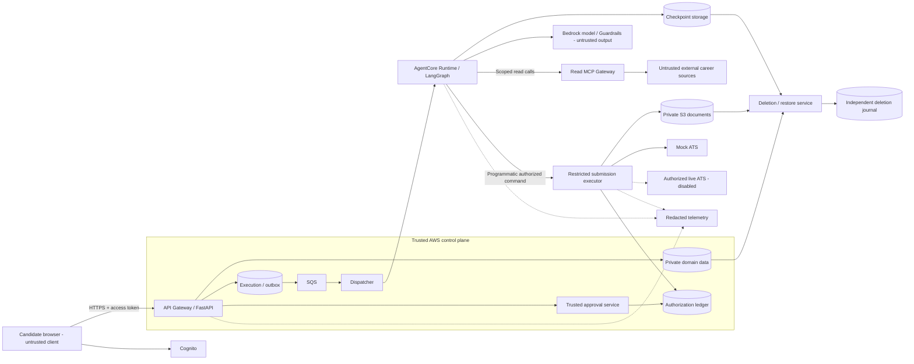

# CareerAutopilot — Security architecture and threat model

Version: 1.0 | Date: 2026-11-25 | Status: owner-approved security design; implementation and validation pending
Parent: [HLD](../02-architecture/high-level-design.md) · [LLD](../02-architecture/low-level-design.md) · [Data model](../02-architecture/data-model.md) · [NFR](../01-product/non-functional-requirements.md) · [Evaluation plan](../01-product/evaluation-plan.md) · [CA-006](https://github.com/palamsaiteja333/career-autopilot/issues/6)

## 1. Scope, assets and assumptions

Single authenticated candidate, public source repository with synthetic fixtures only, private AWS deployment in preferred Canada Central subject to regional feature, model, processing and price validation. Two known workflows; search read-only, application only after selection, original resume, individual exact-payload approval expiring after 24 elapsed hours. Mock ATS is guaranteed MVP execution path; real adapters disabled until separate permission and release approval. No LinkedIn automation, CAPTCHA bypass or unauthorized scraping. Treat all internet content, tool results, uploaded documents and model outputs as untrusted inputs. Threat actors include malicious job posters/sites, compromised dependency/provider, stolen user session, malicious or misconfigured tool, stale worker and operator error. No security/compliance certification claimed.

| Asset | Classification | Control objective |
|---|---|---|
| Public repository/skills/code | Public, integrity-sensitive | Review changes, no real candidate facts or secrets |
| Job content | External untrusted; public source text | Preserve evidence, sanitize rendering, no instruction authority |
| Search interests/history | Private | Owner-only, 90-day retention |
| Resume, profile, application answers and drafts | Restricted personal data | Owner scope, least privilege, encryption, consent and deletion |
| Approval and attempt ledger | Restricted, integrity-critical | Trusted service only, exact versions, no replay |
| Credentials/token/signing config | Secret | Managed secrets, rotation, short-lived identities, never logged |
| Checkpoints/outbox | Private/control-critical | Fenced writes, bounded references, replay-safe |
| Operational telemetry | Internal, redacted | No raw prompts, answers, resumes, URLs with tokens, browser artifacts |

## 2. Trust boundaries and data flow

Trust boundaries: internet/browser to authenticated API; API to data/control services; runtime to model; MCP to external untrusted sites; runtime to privileged executor; private data to external approved ATS; deployment/operations and backups. The model is not a security principal or authorization source. Bedrock input/output filtering is defense-in-depth, not guaranteed prevention. Restrict what tools and data the model can access even when prompt injection succeeds.

## 3. Authentication and authorization

Cognito single owner allowlisted; disable self-registration, offer optional MFA (owner-approved; strongly recommended), OAuth authorization code + PKCE, validate access token issuer/audience or client ID as appropriate, expiry/token use/scopes at gateway and server. Do not rely on browser-provided owner IDs or role flags. Use short-lived tokens; keep browser access token in memory where feasible, do not store long-lived credentials in localStorage. Define reauthentication for sensitive operations (submission approval, profile deletion) and session expiry/revocation policy during implementation. Restrict CORS to configured UI, enforce HTTPS, protect against CSRF if cookie sessions introduced, use CSP and output escaping. All object/record reads and writes owner-scoped; return safe not-found for non-owned references. Internal commands validated by trusted service identities and current owner/deletion generation. No public direct invocation of agent runtime or MCP gateway.

### Proposed IAM / service capability matrix

| Principal | Allowed | Explicitly not allowed |
|---|---|---|
| Browser/candidate | Authenticated API, scoped upload/download intent | Direct DynamoDB access, unrestricted S3, runtime/Gateway invocation |
| API identity | Owner-scoped domain service, ingress/commands, profile operations via trusted services | Raw submission executor credentials, unrestricted tool or ledger writes |
| Approval service | Read draft/ownership, create/revoke approval and update gate through conditional transaction | Send external application, change approved resume content |
| Scheduler/ingress | Read schedule config and accept due search command | Start application without explicit candidate selection, read resume |
| Outbox relay | Read specific execution stream/outbox, publish queue, update publication marker | Read profile, modify approval, submit |
| Dispatch worker | Consume queue, claim execution lease, invoke approved runtime | Read raw resume, direct submit, broad model or data privileges |
| Agent runtime | Scoped domain access via services, checkpointer, Bedrock invocation and permitted read tools; request restricted executor by typed command | Write approval/attempt ledger directly, arbitrary HTTP/shell/credential export |
| Discovery tool role | Approved public source credentials and egress | Candidate profile/S3/approval access or submission |
| Submission executor | Read exact approved document/payload, independent ledger/gate checks, approved adapter credential, narrow send capability | Generic upload, bulk apply, approval creation, arbitrary destination |
| Reconciler | Read provider status when authorized, recover leases/outbox and update evidence via policy service | Blind resend, create approvals, unrestricted profile |
| Deletion/restore | Scoped purge, independent journal, disable/restore gate | Create approvals or submit; unlock requires separate explicit authorized operator action |
| CI deploy role | GitHub OIDC scoped repo/environment, approved CDK resources and artifact registry | Long-lived AWS key, unrestricted production-data read |
| Telemetry exporter | Publish redacted logs/metrics/traces | Raw candidate data, secrets, document store access |

Implement separate roles, service actions, key grants and environment-specific ARN restrictions. Separate read and write gateway identities or gateways when necessary; never bind submission tool to model. IAM conditions and resource policies complement domain checks, not replace them. Avoid broad wildcard permissions; where AWS service requires wildcard document why and restrict by conditions. The runtime may request a submission command only through deterministic node; restricted executor independently validates authorization, including current deletion and restore gates. No tool can accept a model's assertion of approval.

## 4. Threat model (STRIDE plus agent-specific risks)

STRIDE: Spoofing, Tampering, Repudiation, Information disclosure, Denial of service, Elevation of privilege. Severity is qualitative pre-control impact/likelihood prioritization for design, not a measured risk score. All residual risks require test evidence; no threat is marked mitigated simply because a design exists.

| ID | Threat / STRIDE | Priority | Proposed controls | Verification / residual risk |
|---|---|---|---|---|
| TM-01 | Stolen session / identity spoofing (S) | High | Optional MFA, short-lived tokens, owner allowlist, server checks, sensitive action reauth | Invalid/replayed token and revocation tests; stolen valid session remains risk; password-only accounts have elevated credential-theft risk accepted at design stage, not proven mitigated |
| TM-02 | Broken object authorization / cross-owner access (I/E) | Critical | Trusted owner scope on every read, object refs, checkpointer and mutations; no GSI authority | Synthetic cross-owner API/tool/document tests; no real second user needed |
| TM-03 | Indirect prompt injection in job descriptions, forms, PDFs or MCP responses (T/E/I) | Critical | Treat external text as data; guardrails, structured evidence, minimal context, allowlists, isolated read tools, deterministic authorization | Adversarial content; assert no privileged action or unauthorized disclosure even if model follows injected text |
| TM-04 | Resume/profile exfiltration through tools or model outputs (I) | Critical | No PII to discovery providers; scoped private data, minimum Bedrock context, approved destination, no pre-approval external transmission, redaction | Canary facts and instrumented fake destination, inspect tool arguments/network; no sensitive telemetry |
| TM-05 | Excessive agency / unrestricted MCP or browser tools (E) | Critical | Narrow schemas, separate read/write identity, no generic upload/shell/HTTP, executor not model-bound, mock-only default | Unauthorized tool call and argument mutation tests |
| TM-06 | SSRF, redirect and destination spoofing (S/E/I) | High | Approved host and adapter allowlists, canonical URL/identity verification, deny private/loopback/link-local/metadata addresses, resolve/revalidate redirect/DNS at fetch, time/size limits, no arbitrary URL proxy | Safe synthetic endpoint tests including redirect and DNS changes; validate egress mechanism |
| TM-07 | Forged/stale approval or changed payload (T/E) | Critical | Canonical manifest and attachment hashes, server-derived identity/version, 24h expiry, revocation, exact destination/form binding, independent transactional gate | Changed-answer/destination, expired/replayed/cross-job approval tests |
| TM-08 | Duplicate submission, ambiguous timeout, stale worker (T/R) | Critical | Durable attempt + per-job uniqueness, conditional fence, provider idempotency if supported, UNKNOWN reconciliation, no blind retry | Parallel approval, crash after send, replay and stale lease tests; external exactly-once not guaranteed |
| TM-09 | Candidate hallucination or fabricated qualifications (T) | High | Original resume immutable, fact IDs/provenance validation, required unknowns HITL, sensitive answers confirmed, cover letter only on request | Golden data and human review; zero unsupported claims in release cases |
| TM-10 | Malicious file upload or XSS (T/E) | High | Quarantine, size/type/content/scan validation, safe parsers, no macros/execution, HTML escaping/CSP, private storage | Malformed/oversize synthetic files and markup; scanner compatibility/cost pending |
| TM-11 | Secret/PII leakage in logs, traces, queue or GitHub (I) | Critical | Redaction at source, no raw payload telemetry, opaque refs, secret manager, CI scans, disable provider capture where needed | Canary scan across logs/traces/queue and repo; review third-party retention |
| TM-12 | Cost exhaustion / provider throttling / queue flood (D) | High | Authenticated rate/admission limits, quota, per-run budgets, bounded concurrency/retries, DLQ, budget alerts and optional work pause | Saturation, retry storm, budget test; AWS alert delays mean not hard billing cap |
| TM-13 | Data resurrection after deletion or restore (I/T) | Critical | Immediate retrieval revoke, delete all live versions/checkpoints, independent deletion journal, restore write-disabled, retention verification | Deletion during execution, old backup restore, missing tombstone test; managed backup caveat in data model |
| TM-14 | Supply-chain compromise (T/E) | High | Locked deps, dependency/secret scanning, reviewed skill/prompt/model versions, trusted artifacts, least-privilege CI OIDC, protected main | Dependency and artifact verification, PR checks; no secrets in repo |
| TM-15 | Audit tampering or repudiation (R/T) | High | Append-oriented versioned event history, immutable approval/attempt identifiers, scoped write roles, timestamps/correlation, redacted retention | Attempt to modify authorization history via runtime; detect conflicting evidence; not claimed immutable WORM |
| TM-16 | Incorrect regional processing / provider privacy (I) | High | Verify model/feature region, no silent cross-region inference, contracts and retention before real PII, approved integrations | Deployment review with region/process evidence; block actual candidate data until verified |
| TM-17 | Restore/maintenance misconfiguration or public storage (I/E) | Critical | Block public access, TLS/encryption, IaC checks, separate environments, no default live adapters, restore gate | Configuration scans and restore drill; no real production resource exists |
| TM-18 | Race between cancel/delete and external send (T/I) | Critical | Transactional last cancellable boundary, deletion generation checks, no further data retrieval after revoke; in-flight outcome reconciled | Concurrent cancel/send and delete/send tests; external action already started cannot be recalled |

OWASP guidance recognizes prompt injection, sensitive information disclosure and excessive agency as distinct risks. A clean model response does not prove no data was leaked through tools. Our release tests assert actual tool side effects and egress, not only text. Security safety invariants are release blockers, not averages.

## 5. Model, tool and business guardrails

1. Input: validate schema/size/source and label untrusted content. Use Bedrock Guardrails where compatible and verify their data-processing configuration. Limit model input to necessary facts; do not include secrets or whole resume by default.
2. Model output: structured schema, evidence IDs, allowed field type/value, bounded correction; treat as proposal. Reject unsupported claims and unresolved mandatory fields.
3. Tool: deterministic allowlist per workflow/node, independently authenticated caller, scoped refs, allowlisted destination and safe arguments; bounded time/retries. Tool output cannot add permissions or modify system instructions.
4. Business: quota, role/freshness, job identity, required fields, approved original resume checksum, explicit user consent and application state enforced outside LLM.
5. Execution: individual approval bound to exact manifest, 24h elapsed expiry, current gate and per-job attempt reservation. Verify immediately before send; no pre-approval autosave or upload. Mock default. Uncertain external send is UNKNOWN.
6. Human review: display exact data/destination, meaningful questions, clear incomplete handoff and outcome evidence. No confusing or model-generated approval UI claims.

## 6. Privacy and data lifecycle

Minimize stored and transmitted candidate data; only request facts relevant to selected application, never infer sensitive legal/work authorization, demographic or sponsorship details. Explicit per-answer consent and scope for reuse; optional voluntary disclosure left blank or user-directed. Do not persist passwords/OTP as candidate facts. Original approved document unchanged. External employer data retention is outside our control after approved submission; do not imply local deletion retracts it.

Approved retention: profile/resume until deletion, search metadata 90d, logs/traces 30d, minimum application/audit metadata 180d, backup target <=30d, live retrieval immediately revoked and active private data purged within 7d. Data model describes TTL, S3 version deletion, independent deletion journal and restore gate. Private downloads use short-lived presigned URLs only after revocation behavior is validated; URLs are bearer capabilities. Deny existing URL requests at storage/credential boundary on deletion, including object versions; expiry alone and database flags are insufficient. Until proven, disable direct private downloads; broker alternative requires review. Upload intents are restricted to quarantine. No raw PII in telemetry or notification text. Review actual vendor and AWS service-specific storage/logging, model data processing, managed backup behavior and residency before using real personal information. This is engineering policy, not legal compliance advice.

## 7. Operational security, telemetry and incident response

Use TLS, encrypted private storage (AWS defaults: S3 SSE-S3 and DynamoDB AWS-owned keys; no customer-managed KMS key initially), least privilege resource policies, Secrets Manager, CloudTrail for sensitive administrative changes, CloudWatch and OpenTelemetry redacted traces. Avoid expensive blanket data-event logging initially; select necessary events and price them before release. No secrets in CLI logs or CDK outputs. Log event type, opaque owner/run/attempt IDs, version, policy reason, timestamps and outcome; do not log tokens, form values, raw prompts, signed URLs, source content with identifiers or browser screenshots. Disable debug logging and verify model invocation logging/tracing capture. Rate limit logs; retention per NFR.

Incident response proposal: (1) disable submission and optional paid workflows, preserve dashboard/recovery; (2) revoke compromised token/credential and isolate affected tool/environment; (3) preserve minimized evidence and identify scope, unknown external attempts and affected candidate data; (4) correct policy/configuration and rotate credentials; (5) reconcile submissions, apply deletion/retention as appropriate; (6) rerun adversarial and recovery tests, explicitly authorize unlock; (7) record incident and evaluate applicable notification obligations with qualified advice if needed. Alerts: unauthorized action attempt, repeated approval failure, unknown attempt, DLQ, unexpected spend, deletion failure and public-access drift. No real incident occurred.

## 8. Security validation and release gates

- Threat-driven tests TM-01–18 mapped to EV-005–009 and NFR-009–016; synthetic canary data, mock ATS and fake provider endpoints.
- All critical safety tests pass; no unauthorized data exposure, action, fabricated claim, approval bypass, duplicate or lost acknowledged state in defined scenarios.
- Verify IAM policies/credential segregation, private storage, signed URL issuance/revocation (including exact versions and concurrency), upload scanning, TLS, optional MFA and sensitive-action reauth, OIDC and environment isolation. Test actual Gateway/Runtime/checkpointer integration and egress.
- Verify region/model/feature privacy, approved source and live adapter permissions, vendor retention and backup policy feasibility before real candidate data.
- Restore/deletion drill, telemetry redaction scan, dependency/secret scan, quota/race/fencing tests and cost limits.
- Record residual risks, evidence and owner review; never claim risk eliminated. Live submission remains disabled until separate explicit authorization and tested controls.

## 9. Open decisions and references

Approved: optional MFA, default AWS encryption, short-lived signed URLs subject to validated immediate revocation, and remaining security/IAM/STRIDE/privacy/deletion/recovery design. Open implementation validation: sensitive-action reauthentication, exact IAM policies, upload scanner, presigned URL revocation, egress, CloudTrail scope, deletion journal recovery, approval/attempt retention and managed backup behavior. Maximum 30-day backup policy remains unchanged; 35-day PITR table-deletion system backup is a blocking gate, not an exception. Resolve regional cost and service compatibility before deployment; see [ADR-009](../03-decisions/ADR-009-security-privacy-and-retention.md) and [implementation backlog](../07-planning/implementation-backlog.md) for validation work. No code, resources, security tests or actual personal data.

References: [OWASP GenAI Top 10](https://genai.owasp.org/top-10-for-llm-applications-2026/), [OWASP prompt injection prevention](https://cheatsheetseries.owasp.org/cheatsheets/LLM_Prompt_Injection_Prevention_Cheat_Sheet.html), [OWASP tool misuse and exploitation](https://genai.owasp.org/agentic-applications-2026/asi02-tool-misuse-and-exploitation/), [AWS DynamoDB transactions](https://docs.aws.amazon.com/amazondynamodb/latest/developerguide/transaction-apis.html), [AWS S3 version deletion](https://docs.aws.amazon.com/AmazonS3/latest/userguide/DeletingObjectVersions.html). References inform controls, not certification.
