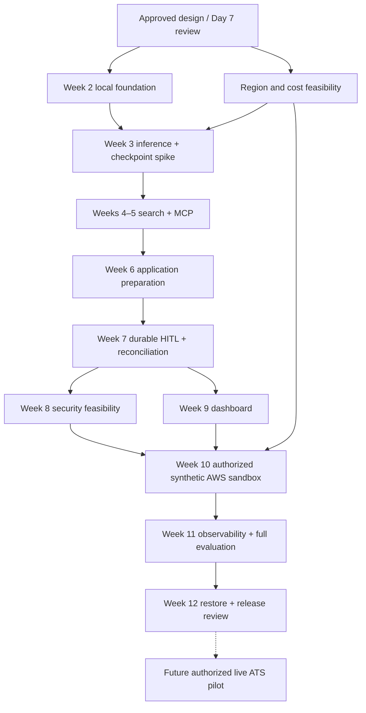

# CareerAutopilot — Implementation backlog and delivery plan

Version: 0.1 | Date: 2026-11-25 | Status: proposed implementation sequence for owner review; no code or resources created
Parent: [ADRs](../03-decisions/README.md) · [HLD v1.0](../02-architecture/high-level-design.md) · [LLD v1.0](../02-architecture/low-level-design.md) · [Data model](../02-architecture/data-model.md) · [Threat model](../04-security/threat-model.md) · [Engineering backlog](engineering-backlog.md)

## 1. Delivery strategy

Documentation-first design completed through Day 6. Day 7 records the accepted design and proposes a dependency-ordered implementation plan. Week numbers are learning modules, not delivery commitments; scope or feasibility may require reordering. Single-owner, USD 50/month target, synthetic data by default. No implementation or cloud expenditure authorized here. P0 = MVP/release dependency; P1 = required supporting learning/quality deliverable or enhancement that can be sequenced after a P0 foundation; P2 = deferred, conditional future work. All referenced dependencies must have their stated acceptance evidence before dependent production release; synthetic stubs may allow parallel local learning with explicit gaps. A feasibility spike is a test, not a decision to deploy.

| Milestone | Weeks | Exit evidence |
|---|---|---|
| M2 Engineering Foundation | 2–3 | Reproducible local service and CI, domain contracts, inference/evaluation adapter, checkpoint spike, traceable synthetic workflows |
| M3 Job Discovery MVP | 4–5 | Mock-first search graph, permitted source adapters, MCP/skills, freshness/dedup/ranking and discovery goldens |
| M4 Application Assistance MVP | 6–8 | Original resume, mock ATS, quota, durable HITL, independent approval and reconciliation; security feasibility gates |
| M4 dashboard integration | 9 | Candidate-facing synthetic end-to-end experience |
| M5 AWS Release & Operations | 10–12 | Authorized synthetic sandbox, deployment evidence, full evals, cost, restore and release review |
| Future conditional | After M5 | Separate authorization and pilot for a live ATS only if supported |

## 2. Prioritized work items

Stable IMP IDs are planning identifiers, not GitHub issue numbers. Create individual GitHub issues only after plan review or explicit request; no native milestone objects created by this document.

| ID | Week | Priority | Work item | Depends on | Definition of done / acceptance evidence | Traceability |
|---|---|---|---|---|---|---|
| IMP-001 | 2 | P0 | Regional capability and cost feasibility matrix | None | Verify ca-central-1 features/models/processing paths, runtime/Gateway, CDK service limits and licensed-search cost against $50 target; record evidence, blockers and alternatives; no real candidate data or spend. | ADR-011; NFR-017 |
| IMP-002 | 2 | P0 | Python workspace and repository foundations | None | Create approved Python/uv project, module boundaries, environment template, lint/type/test setup and synthetic fixtures; repeatable local setup, no secrets. | LLD §1; NFR-020 |
| IMP-003 | 2 | P0 | CI quality and security checks | IMP-002 | PR runs lint/type/unit smoke, dependency/secret scans and synthetic fixtures; reviewed failures block merges; document protected branch and OIDC plan. | ADR-010,011; TM-14 |
| IMP-004 | 2 | P0 | Typed domain contracts and deterministic policies | IMP-002 | Validate IDs, preferences, job schema, application states, timezone, quota rules, consent/approval manifest; unit tests cover unknown eligibility, DST, invalid transition. | FR-002–018; LLD §3 |
| IMP-005 | 2 | P0 | FastAPI local control plane and identity boundary | IMP-004 | Health and versioned conceptual REST routes, dependency-injected repositories, synthetic authenticated owner and negative ownership tests; local mock auth never enabled in cloud. | LLD §2; NFR-011 |
| IMP-006 | 2 | P0 | Local persistence and baseline tracing | IMP-004, IMP-005 | Durable local test adapters for state, commands and private document refs; correlation ID, redacted logs, OTel traces; restart smoke test. | ADR-004,010; NFR-007,015 |
| IMP-007 | 3 | P0 | Bedrock structured inference adapter | IMP-001, IMP-004, IMP-006 | Model selection benchmark plan; validate structured schema and one correction with mocks; permitted sandbox inference only after spend authorization; record region, model, tokens, costs. | ADR-005; EV-004,006 |
| IMP-008 | 3 | P0 | Guardrails, model budgets and evaluation foundation | IMP-007 | Bound calls/tokens/time, label untrusted data, validate evidence and use canary redaction tests; initial versioned goldens, model evaluation harness and held-out split. | NFR-013,017,018; EV-001–010 |
| IMP-009 | 3 | P0 | Checkpoint compatibility spike | IMP-001, IMP-006 | Prove LangGraph stable thread and interrupt resume across process restarts, and stale-writer exclusion on synthetic state; evaluate selected DynamoDB checkpointer in authorized sandbox before cloud release; document fallback if unsupported. | ADR-002,004; NFR-007 |
| IMP-010 | 4 | P0 | Source catalog and permitted access review | IMP-001, IMP-004 | Record company/board/site IDs, permitted interfaces and vendor terms, coverage, pagination, data flow and costs; unapproved integrations disabled; synthetic source fixtures. | ADR-008; JS-003 |
| IMP-011 | 4 | P0 | Job normalization and identity service | IMP-004, IMP-010 | Stable provider/canonical aliases, source provenance, 48h UTC freshness, geographic evidence, unknown and duplicate cases tested. | JS-004–009; EV-002 |
| IMP-012 | 4 | P0 | Job Search StateGraph with mock sources | IMP-007, IMP-008, IMP-009, IMP-011 | Implement 11-node design with deterministic filtering, bounded fit batches, ranking <=10, partial/all-failure outcomes, manual clarification and persisted results using mock tools. | JS-001–016; EV-001,002 |
| IMP-013 | 5 | P0 | Local MCP server and typed client | IMP-004, IMP-010 | Implement narrow read contracts; schema/permission tests, error taxonomy, two transient retries after initial attempt, bounded deadline; no generic HTTP/shell. | ADR-006; JS-015 |
| IMP-014 | 5 | P0 | Versioned agent skills and read-only adapters | IMP-008, IMP-012, IMP-013 | Six reviewed skill definitions, activate at approved nodes; permitted company/ATS/search adapters only after source review, verified links and coverage; no private candidate data to discovery providers. | LLD §6–7; TM-03–06 |
| IMP-015 | 5 | P1 | Discovery evaluation and scheduling contract | IMP-012, IMP-014 | Run initial discovery goldens, report precision/recall, hard filters, coverage, latency and cost; schedule slot idempotency and 24h elapsed semantics; exact anchor/channel remain configurable pending owner decision. | EV-001–003; NFR-006 |
| IMP-016 | 6 | P0 | Candidate profile, verified facts and original document lifecycle | IMP-004, IMP-006 | Versioned profile, scope/consent, immutable checksum, synthetic uploads/quarantine/validation; no real personal data; cover letter explicit request. | JA-004–009; TM-10 |
| IMP-017 | 6 | P0 | Mock ATS, form inspection and answer mapping | IMP-007, IMP-008, IMP-013, IMP-016 | Mock conditional form schema, typed mapping, up to 15-question batches, known/unknown fields, fact provenance and no pre-approval data transmission. | JA-006–011; EV-004–006 |
| IMP-018 | 6 | P0 | Application StateGraph preparation | IMP-009, IMP-017 | 14-node workflow boundaries and safe routing, user-selected only, five unique daily quota, original resume, input/review drafts; mock/handoff only; no actual external actions. | JA-001–014 |
| IMP-019 | 7 | P0 | Durable command, outbox, quota and fencing protocol | IMP-006, IMP-009, IMP-018 | Atomic acceptance, idempotency, conditional claim, duplicate delivery, stale-worker and dual-write fault tests; local durable simulation plus authorized DynamoDB integration test before cloud release. | ADR-003,004; EV-009 |
| IMP-020 | 7 | P0 | Human interrupts, approvals and restricted executor | IMP-018, IMP-019 | Restart/resume, exact immutable payload/destination approval, 24h expiry, reapproval and cancellation; isolated mock submission identity and attempt ledger. | ADR-007; EV-005–009 |
| IMP-021 | 7 | P0 | Reconciliation and fault-injection suite | IMP-020 | Crash after mock send, unknown state, duplicate attempt lock, no blind retry, recovery after confirmed no-send with fresh approval; DLQ and outbox replay tests. | NFR-007–009; TM-07,08,18 |
| IMP-022 | 8 | P0 | IAM, authentication and tool security baseline | IMP-001, IMP-005, IMP-013, IMP-020 | Optional MFA, owner isolation, sensitive reauth design, separate IAM roles, deny unsafe destination/SSRF, model cannot grant permission; synthetic adversarial suite. | ADR-009; TM-01–08 |
| IMP-023 | 8 | P0 | Storage encryption, signed URL and deletion feasibility | IMP-001, IMP-016, IMP-022 | SSE-S3/AWS-owned DynamoDB keys; short-lived scoped URL issuance and test revocation of already issued URLs including exact versions; deletion/late upload and purge tests; block private data if not proven. | TM-02,04,10,13; NFR-014 |
| IMP-024 | 8 | P0 | Backup retention and independent restore journal feasibility | IMP-001, IMP-019, IMP-022 | Demonstrate <=30-day backup behavior including PITR table-deletion caveat using synthetic resources or compliant alternative; restore with deletion journal and write-disabled gate; unresolved blocks real-data release. | NFR-010,014; TM-13,17 |
| IMP-025 | 9 | P0 | React dashboard and candidate controls | IMP-005, IMP-015, IMP-018, IMP-020 | Search results, coverage, job selection, original resume, pending answers, exact individual review, quota, statuses and cancellation; mock-only end-to-end UX; no false submitted status. | FR-003–015 |
| IMP-026 | 10 | P0 | AWS CDK and OIDC deployment foundation | IMP-001, IMP-003, IMP-019, IMP-022 | Reviewed IaC, environment separation, minimal IAM, ECR, budget alerts, rollback and synthetic data only; no paid resources until explicit approval; deploy only validated region. | ADR-011; NFR-011,017,020 |
| IMP-027 | 10 | P0 | Deploy bounded API/runtime/queue/identity path in sandbox | IMP-009, IMP-021, IMP-023, IMP-024, IMP-025, IMP-026 | Verify API Gateway/Lambda, DynamoDB/S3, EventBridge, SQS/DLQ, AgentCore Runtime and Gateway, checkpoint compatibility, Cognito and signed URL controls; run synthetic smoke tests; if retention/revocation gate unresolved, disable affected feature and use isolated synthetic validation only. | HLD v1.0; ADR-001–004,009 |
| IMP-028 | 11 | P0 | Distributed tracing, monitoring and budget controls | IMP-008, IMP-021, IMP-027 | Trace links across API/outbox/queue/graph/MCP; metrics/alarms, redaction, per-run usage and actual bill reconciliation; no raw sensitive payloads; test cost threshold behavior. | ADR-010; NFR-015–018 |
| IMP-029 | 11 | P0 | Full evaluation and performance suite | IMP-015, IMP-021, IMP-022, IMP-023, IMP-024, IMP-025, IMP-027, IMP-028 | Versioned goldens, 30 search/30 application/20 adversarial/15 reliability minima, held-out results; measure p95, accuracy, SLO indicators and cost; all safety assertions pass; report misses honestly. | EV-001–010 |
| IMP-030 | 12 | P0 | Operational recovery and release readiness | IMP-027, IMP-028, IMP-029 | Restore/rollback drill, RTO/RPO evidence, deletion proof, incident runbook, permissions review and budget; independent release checklist and owner approval; no live submit or real PII before gates pass. | NFR-010,014,020 |
| IMP-031 | 12 | P1 | Extensibility and teaching/interview documentation | IMP-029, IMP-030 | Demonstrate synthetic third-workflow registration without altering existing business logic, document architectural trade-offs, traces, failure demos and learning notes; not a new production agent. | NFR-019; ADR-012 |
| IMP-032 | Future | P2 | Authorized live ATS pilot | IMP-030 | Separate explicit owner and provider authorization, contract and privacy review, tested exact approval and idempotency/reconciliation; otherwise retain manual handoff. No auto-enable on MVP completion. | FR-013; JA-015; ADR-007 |

## 3. Week 2 engineering foundation: daily learning and deliverables

| Day | Focus | Tasks |
|---|---|---|
| Day 1 | Review feasibility, initialize project structure, Python and uv decisions | IMP-001,002 |
| Day 2 | Typed domain models, state and business rules | IMP-004 |
| Day 3 | FastAPI request lifecycle, validation, auth boundary | IMP-005 |
| Day 4 | Repository interfaces and local durable state | IMP-006 |
| Day 5 | CI, tests, dependency and secret scanning | IMP-003 |
| Day 6 | OpenTelemetry baseline and restart/negative tests | IMP-006 |
| Day 7 | Demonstration, review and engineering notes | Review IMP-001–006 acceptance evidence; carry blockers explicitly |

Foundation acceptance is local-first. Cloud compatibility experiments may require separate approval and synthetic staging resources; no need to use actual resumes, real submissions or deploy the complete AWS estate during Week 2.

## 4. Dependency and release gates

| Gate | Required evidence | If unmet |
|---|---|---|
| G0 Design review | ADRs and backlog reviewed; CA-001/007 status reconciled | Do not start implementation until explicit go-ahead |
| G1 Regional/budget | Actual feature/model availability and residency, licensed search, estimated/observed pricing against USD 50; separate spend authorization | Keep mocks/local; propose revised ADR for material changes |
| G2 Checkpoint/dispatch | Cross-invocation resume, stale-writer exclusion, durable acceptance/outbox and reconciliation tests | Do not enable external writes; validate alternative |
| G3 Security/privacy | IAM, optional MFA/reauth, signed URL revocation for already issued URLs/versions, no PII leakage, deletion/restore and <=30-day backup retention (including PITR system backup) | Block real private data and affected functionality; no silent exceptions |
| G4 AI/reliability quality | Approved evaluation targets and all safety invariants on versioned synthetic datasets; documented performance and cost | Remediate and rerun; non-safety changes need review |
| G5 MVP release | Runbook, rollback, restore and owner release decision | No production-readiness claim |
| G6 Live external action | Independently authorized provider integration, exact user approval, tested idempotency/reconciliation and separate pilot approval | Mock ATS and manual handoff only |

## 5. Standard definition of done

Every implementation issue includes requirement/ADR references, clear inputs/outputs, testable acceptance, negative/failure cases, docs and a demo or evidence link. Changes use small branches/PRs; unit tests for deterministic logic, contract tests for integrations, golden evaluations where model behavior changes. Record code/model/prompt/skill/tool versions and trace IDs; no raw candidate data, secrets or private traces in public GitHub. Update README/docs and learning notes explaining the concept and trade-off. No issue closes solely because code exists. No deploy or real external action without the relevant authorization and release gates.

## 6. Outstanding decisions / blockers

- Model and search provider, actual Canada Central availability and private processing, real regional cost and source permissions.
- Checkpointer integration/fencing and runtime/queue timeout compatibility.
- Signed URL revocation (expiry alone insufficient); immediate retrieval revoke remains mandatory.
- DynamoDB PITR table deletion may retain a 35-day system backup; preserve approved 30-day maximum and validate compliant backup design.
- Discovery notification channel and schedule anchor, scoring calibration, upload scanner, exact reauthentication and retention implementation.
- Native GitHub milestones not yet created; CA-001 remains open for final product-doc review and CA-007 for Day 7 review. No implementation GitHub issues created yet.

This backlog is a proposed plan. Approval of prior design does not establish measured feasibility, authorize spend, or permit actual candidate-data processing or external job submissions.
